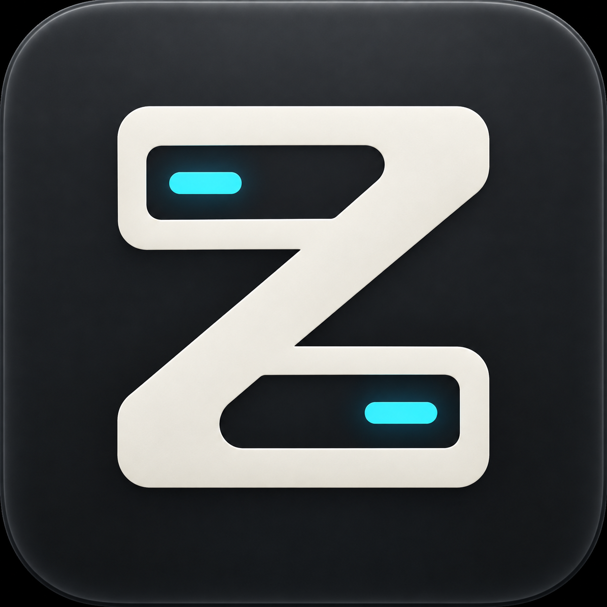

<p align="center">
  
</p>

<h1 align="center">zmux</h1>

<p align="center">
  <b>A fast, native terminal workspace for macOS, built to keep up with your coding agents.</b><br>
  Split panes, SSH workspaces, and an inbox that tells you when a terminal needs you.
</p>

<p align="center">
  <a href="https://github.com/ashutoshpw/zmux/actions/workflows/check.yml"></a>
  <a href="https://github.com/ashutoshpw/zmux/actions/workflows/macos-development.yml"></a>
</p>

> **Status: early development.** zmux runs today as a macOS development build.
> Expect rough edges and missing features. See [what works](#what-works-today) and
> [what's next](#whats-next).

## Why zmux?

Running several shells, SSH sessions and AI coding agents at once means constantly
hunting for the terminal that just finished, or the one that is waiting on you.
zmux keeps them organized and tells you which one needs attention.

- **Workspaces and split panes.** Group your terminals, split them, and reorder
  workspaces by dragging them in the sidebar.
- **An attention inbox.** Terminal bells, desktop-notification escape codes and
  `zmux notify` land in one inbox with unread badges and a Dock badge. Nothing is
  flagged just because a terminal printed output.
- **Claude Code aware.** When a Claude session finishes a turn or asks for
  permission, the terminal it came from lights up. This works locally and over SSH,
  and it never edits your Claude settings.
- **Built-in browser tabs.** Open links from your terminal in an embedded browser tab
  next to your shells.
- **SSH workspaces.** `zmux ssh` respects your OpenSSH config and jump hosts.
- **Scriptable.** A bundled `zmux` CLI controls the app over a private local socket.
- **Native and lightweight.** A thin Swift/AppKit interface sits on a Rust core that
  handles the terminals and workspace state.
- **Scrollback that stays.** Keeps 1,000 lines of history, even after a process exits.

## Quick start

zmux is not on a stable release channel yet. The easiest way to try it is a
development build.

1. Open a successful run of the
   [macOS development build workflow](https://github.com/ashutoshpw/zmux/actions/workflows/macos-development.yml)
   and download `zmux-macos-dev-universal-<sha>` from its **Artifacts** section
   (GitHub sign-in required, artifacts expire after 14 days).
2. Extract it, then extract the inner `zmux-dev-universal-<sha>.zip`, and move **zmux**
   to your Applications folder (macOS 14+, Apple Silicon or Intel).
3. The build is ad-hoc signed and not notarized, so macOS may ask you to approve it in
   **System Settings → Privacy & Security → Open Anyway**.

Full steps are in [development builds](docs/development-builds.md).

Or build it yourself:

```sh
scripts/build-macos-dev      # macOS 14+
```

### Just curious? Try the headless demo (any OS)

```sh
cargo run --locked -p zmux -- prototype -- /bin/sh -c 'printf "Hello from zmux\n"'
```

This runs a command in a real terminal session and prints the final screen as JSON.
No window needed. Details: [prototype limits](docs/terminal-prototype.md).

## What works today

| | |
|---|---|
| Local shells, workspaces, split panes | ✅ |
| Mouse selection and <kbd>⌘C</kbd> copy | ✅ |
| Notifications inbox, badges, Claude plugin | ✅ |
| SSH workspaces (`zmux ssh`) | ✅ (a subset of OpenSSH options) |
| Automation CLI over a local socket | ✅ (incomplete command set) |
| Scheduled messages to remote tmux panes | ✅ |
| Remote terminal access between devices | 🚧 in progress |
| Cloud sync and accounts | 🚧 built, not yet hosted |
| Mobile clients | 🗓 planned |

## Using zmux

<details>
<summary><b>Scrolling and history</b></summary>

Scroll with the mouse wheel or trackpad. <kbd>Shift</kbd>+<kbd>PageUp</kbd>/<kbd>PageDown</kbd>
moves a page. <kbd>⌘</kbd>+<kbd>Home</kbd>/<kbd>End</kbd> jumps to the oldest output or back
to live. Typing or pasting returns you to live output. In full-screen apps that capture
the mouse, hold <kbd>Shift</kbd> to scroll history instead.
</details>

<details>
<summary><b>Notifications and the Claude plugin</b></summary>

Selecting a terminal, or reactivating its window, clears its attention. Opening an inbox
entry clears that entry. macOS banners need notification permission and respect Focus
modes. Without permission you still get the inbox.

Interactive zmux shells add a session-only Claude plugin automatically. To turn things off:

```sh
ZMUX_CLAUDE_INTEGRATION_DISABLED=1   # skip the Claude integration
ZMUX_SHELL_INTEGRATION_DISABLED=1    # skip all shell integration (set before launching zmux)
```

`zmux hooks claude` is separate. It manages opt-in agent messaging.
</details>

<details>
<summary><b>Automation and SSH</b></summary>

See [local control](docs/local-control.md) for the CLI and socket access modes,
[SSH workspaces](docs/ssh.md) for supported options, and
[scheduling](docs/scheduling.md) for timed tmux messages.
</details>

## What's next

Remote terminal transport, cloud hosting, mobile clients, and polish on input methods
and accessibility are still ahead. The next public build waits until native, remote and
stability testing all pass.

## Contributing

Contributions are welcome. Read [AGENTS.md](AGENTS.md) first, then:

```sh
# Rust 1.95.0 with rustfmt and clippy
scripts/check
```

`scripts/check` runs formatting, tests, lints and the license inventory. On Linux it
also needs `openssh-server` and `ssh-keygen` for the SSH tests. Native UI work needs a
Mac running macOS 14+.

<details>
<summary><b>How it's built</b></summary>

- **Rust core:** workspace state (`crates/workspace-core`), PTY sessions
  (`crates/session-runtime`), and the C bridge to Swift (`crates/native-bridge`).
- **Swift/AppKit app:** `apps/macos`. It handles presentation only and shares actions
  with the Rust core.
- **Cloud service:** `services/control-plane` (identity and device registry).

More: [architecture](docs/architecture.md) ·
[native bridge](docs/native-bridge.md) · [dependencies](docs/dependencies.md) ·
[cloud deployment](docs/cloud-deployment.md)
</details>

## License

See [LICENSE](LICENSE) and [third-party notices](THIRD_PARTY_NOTICES.md).
Dependencies keep their own licenses.
